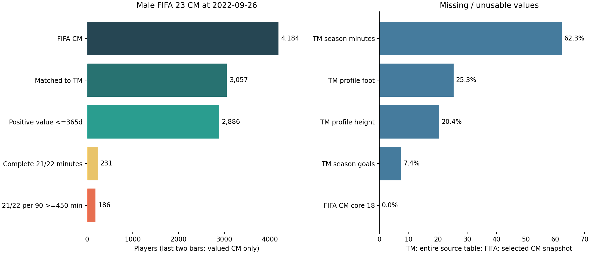

# Moneyball 2.0: фактический Data Profiling и зафиксированный Feature Set v1

Дата аудита: **07.11.2026**. Исследованы именно три предоставленных ZIP из Downloads. Все **19 CSV** прочитаны полностью, включая мужской файл размером 5 637 100 640 байт после распаковки. Выборка строк для основных количеств не использовалась.

**Решение:** основной срез — мужская FIFA 23 на **26.09.2022**. Поиск похожих игроков: **4 184 CM × 18 игровых характеристик**. Модель записанной рыночной оценки: **2 886 CM × 27 исходных признаков** после сопоставления и датированного join. Это окончательная спецификация **v1**, выбранная по покрытию, смыслу и временной доступности. Предсказательная полезность ещё не проверялась обучением и абляциями.



## 1. Реальные размеры и пропуски

| Архив | CSV | Строк | Столбцов | Пустых ячеек | % пустых | Повторов строк |
| --- | --- | --- | --- | --- | --- | --- |
| fifa_male | `male_players (legacy).csv` | 161 583 | 110 | 1 218 702 | 6.86 | 0 |
| fifa_male | `male_teams.csv` | 385 055 | 54 | 4 172 566 | 20.07 | 0 |
| fifa_male | `male_players.csv` | 10 003 590 | 110 | 75 828 244 | 6.89 | 0 |
| fifa_male | `male_coaches.csv` | 1 155 | 8 | 888 | 9.61 | 0 |
| fifa_female | `female_coaches.csv` | 52 | 8 | 55 | 13.22 | 0 |
| fifa_female | `female_players (legacy).csv` | 3 196 | 110 | 46 602 | 13.26 | 0 |
| fifa_female | `female_players.csv` | 181 361 | 110 | 2 883 528 | 14.45 | 0 |
| fifa_female | `female_teams.csv` | 7 941 | 54 | 115 261 | 26.88 | 0 |
| transfermarkt | `player_injuries.csv` | 143 195 | 7 | 1 567 | 0.16 | 111 |
| transfermarkt | `player_latest_market_value.csv` | 69 441 | 3 | 0 | 0.00 | 0 |
| transfermarkt | `player_market_value.csv` | 901 429 | 3 | 0 | 0.00 | 0 |
| transfermarkt | `player_national_performances.csv` | 92 701 | 9 | 159 970 | 19.17 | 32 |
| transfermarkt | `player_performances.csv` | 1 878 719 | 20 | 1 308 760 | 3.48 | 0 |
| transfermarkt | `player_profiles.csv` | 92 671 | 34 | 1 508 269 | 47.87 | 0 |
| transfermarkt | `player_teammates_played_with.csv` | 1 257 342 | 6 | 1 876 410 | 24.87 | 0 |
| transfermarkt | `team_children.csv` | 7 695 | 5 | 0 | 0.00 | 0 |
| transfermarkt | `team_competitions_seasons.csv` | 196 378 | 7 | 96 567 | 7.02 | 143 359 |
| transfermarkt | `team_details.csv` | 2 175 | 12 | 2 024 | 7.75 | 0 |
| transfermarkt | `transfer_history.csv` | 1 101 440 | 10 | 582 | 0.01 | 123 |

Суммарно прочитано **16 487 119 строк** и найдено **89 219 995 пустых ячеек**. Сумма строк разных таблиц — объём записей, а не число футболистов. Legacy и полную таблицу нельзя складывать как независимых игроков.

Здесь «пропуск» — пустое CSV-поле (включая пустую строку в кавычках). Нули, `N/A` и `-` сохранены отдельно, чтобы не смешивать отсутствие данных с реальным нулём. В TM profiles дополнительно **1 778** текстовых маркеров неизвестного значения и **18 867** невозможных значений роста 0 см. После преобразования этих известных маркеров в null число отсутствующих/непригодных ячеек profiles становится **1 528 914**, вместо **1 508 269** только пустых. Это правило очистки, а не изменение исходного файла.

См. полные счётчики и доли **для каждого столбца** в [таблицах колонок](../reports/data_profiling/transfermarkt_columns.csv), [FIFA male](../reports/data_profiling/fifa_male_columns.csv), [FIFA female](../reports/data_profiling/fifa_female_columns.csv). Приблизительный числовой тип выбирался по первой порции; число последующих ошибок преобразования тоже сохранено. Дубликаты полного прохода считались по 64-битным отпечаткам строк и ключей, для небольших TM-таблиц дополнительно проверены точным сравнением.

## 2. Доступные признаки

[Полный словарь фактических схем](data_dictionary.md) перечисляет все столбцы всех таблиц. FIFA players: **110**, teams: **54**, coaches: **8**. Схема игроков одна и та же у мужчин/женщин и у legacy/full.

FIFA содержит игровые атрибуты, биографию, несколько позиций, рост/вес, ногу, work rate, клуб/лигу, оценки overall/potential и игровые финансовые поля. TM содержит профили, историю оценок, сезонные счётчики результативности, переходы, травмы, сборные и связи партнёров. **xG/xA, точности и прогрессивности передач, прессинга и событийных оборонительных метрик здесь нет.** Их нельзя включать в Feature Set как будто они доступны.

`league_name` не уникален: Bundesliga соответствует 2 league_id, Premier League — 3, Primera Division — 4, Super League — 4. Для контекста цены используем категориальный **FIFA league_id**, а не одно название лиги.

## 3. Сколько центральных полузащитников

CM = точный токен `CM` в списке `player_positions`. `CAM`, `CDM`, `LM`, `RM` сами по себе не проходят. «Основной CM» означает CM на первом месте. Все исторические изменения позиции сохраняются.

| Файл | Всего уникальных игроков | CM-записей | Уникальных CM за все версии | Основных CM: уникальных |
| --- | --- | --- | --- | --- |
| `male_players.csv` | 56 880 | 2 081 002 | 14 370 | 9 733 |
| `male_players (legacy).csv` | 49 699 | 33 597 | 12 004 | 7 793 |
| `female_players.csv` | 1 635 | 38 771 | 410 | 252 |
| `female_players (legacy).csv` | 1 266 | 694 | 298 | 188 |

Числа для конкретных срезов приведены ниже. В Transfermarkt **9 546** профилей имеют точное `position = Midfield - Central Midfield`. Это текущая позиция на момент выгрузки, а не исторический фильтр для 2022 года. Среди 3 057 связанных FIFA CM только 1 476 имеют такую текущую позицию TM; дополнительная фильтрация по ней поменяла бы определение выборки и внесла будущую информацию. В TM нет явной колонки пола.

## 4. Проверенное объединение FIFA 23 с Transfermarkt

| Срез | Игроков | CM / основной CM | Сопоставлено всех | % всех | Сопоставлено CM | % CM | CM с годной оценкой |
| --- | --- | --- | --- | --- | --- | --- | --- |
| male_legacy23 | 18 533 | 4 184 / 2 209 | 13 261 | 71.55 | 3 057 | 73.06 | 2 886 |
| female_legacy23 | 814 | 184 / 114 | 0 | 0.00 | 0 | 0.00 | 0 |
| male_players_fifa23_latest | 18 127 | 4 076 / 2 129 | 13 078 | 72.15 | 3 021 | 74.12 | 2 851 |
| female_players_fifa23_latest | 832 | 196 / 112 | 0 | 0.00 | 0 | 0.00 | 0 |

У процента всегда есть знаменатель: все уникальные игроки соответствующего FIFA-среза либо только его CM. 13 261 связанных мужчин — также 14,31% от 92 671 TM profiles; это обратное покрытие, а не основной показатель объединения.

Алгоритм: убрать конечный `(ID)` из имени TM, нормализовать Unicode/диакритику, регистр, дефисы и пунктуацию; использовать long/short name и URL-slug FIFA, player_name/name_in_home_country/player_slug TM. Принимать только **точный алиас + точную дату рождения**, единственный кандидат и взаимно однозначный результат. При расхождении роста свыше 10 см пара помещается в карантин. Клуб не использовался как обязательное совпадение: за три года он мог измениться. Ни одна строка с нечетким совпадением автоматически не попала в обучение.

Для release-среза в очередь проверки попали 282 строки нечетких кандидатов, 58 пар с конфликтом роста и 1 неоднозначное точное совпадение. Количество строк кандидатов не равно количеству игроков. **71,55% / 73,06% — достигнутое автоматическое покрытие по этому правилу, а не измеренная точность или доказательство, что остальные игроки отсутствуют в TM.** Размеченного эталона для оценки precision/recall нет.

Прямой join по `player_id` дал бы **1 581** пару мужчин, причём **ни у одной не совпала дата рождения**. У женщин — 58 таких ложных пересечений ID. Идентификаторы SoFIFA и Transfermarkt принципиально разделены на `fifa_id` и `tm_id`.

Стоимость: взять последнюю запись `player_market_value.date_unix <= 2022-09-26`. Затем оставить `value > 0`, возраст оценки ≤365 дней. Цепочка потерь:

| Шаг | CM |
| --- | --- |
| Все FIFA CM | 4184 |
| Нет надёжной связи с TM: исключено | 1127 |
| Связь есть, исторической оценки нет: исключено | 95 |
| Нулевая оценка: исключено | 7 |
| Положительная оценка старше 365 дней: исключено | 69 |
| Осталось для модели цены | 2886 |

Выбор 365 дней — зафиксированное правило v1, не найденный оптимум. Покрытие при 90/180/365/730 днях: **904 / 2 760 / 2 886 / 2 913 CM**. Этот порог требует анализа чувствительности при моделировании.

У всех join проверена ожидаемая кратность: FIFA ↔ mapping **one-to-one**, оценка ↔ игрок **many-to-one** после выбора одной даты. Число исходных игроков не увеличивается. Вся история оценок не присоединялась напрямую к признакам: это создало бы много строк на игрока.

## 5. Даты, сезоны и исторический срез

| FIFA | Дата legacy | Мужчин | CM | Основной CM | CM с полными 18 X |
| --- | --- | --- | --- | --- | --- |
| 15 | 2014-09-18 | 16 182 | 3 307 | 1 955 | 0 |
| 16 | 2015-09-21 | 16 679 | 3 338 | 1 950 | 0 |
| 17 | 2016-09-20 | 17 566 | 3 392 | 2 005 | 3 392 |
| 18 | 2017-09-18 | 17 928 | 3 580 | 2 002 | 3 580 |
| 19 | 2018-08-21 | 18 086 | 3 787 | 2 179 | 3 787 |
| 20 | 2019-09-19 | 18 483 | 3 875 | 2 213 | 3 875 |
| 21 | 2020-09-23 | 18 887 | 3 930 | 2 232 | 3 930 |
| 22 | 2021-09-23 | 19 239 | 4 204 | 2 173 | 4 204 |
| 23 | 2022-09-26 | 18 533 | 4 184 | 2 209 | 4 184 |

Полный мужской файл: **2014-08-29 — 2023-01-13**, 558 комбинаций версия–обновление–дата. Женский: **2015-08-28 — 2023-01-13**, 519 комбинаций. Это реальные обновления FIFA, не регулярная недельная панель и не даты матчей. Точный список сохранён в `*_snapshots.csv`.

У женщин legacy есть FIFA 16–23, с теми же годовыми датами после 2015 года. **Полный набор из 18 атрибутов доступен в legacy начиная с FIFA 17 / 20.09.2016**. В FIFA 15/16 отсутствует `mentality_composure`: нельзя заполнять его значением из будущей версии. Для неизменного X использовать исторические срезы 2016–2022; более ранний период потребует отдельной спецификации.

История TM market value: **2003-12-14 — 2025-09-11**. Latest-файл: 2004-10-03 — 2025-09-11; он точно совпадает с последней записью истории у всех 69 441 игроков и не расширяет данные. **48 468** его строк датированы позже основного cutoff, поэтому latest запрещён для исторического join.

В performances есть двухгодичные сезоны **60/61 — 25/26** и календарные годы **1960 — 2026**, но ранние/будущие края крайне редкие: 1960 — 1 строка, 2026 — 177 строк. Это диапазон меток, не гарантия достоверного покрытия каждого года. Для TM клубных сезонов `season_id` доступны **2000–2025**. Все значения и количества сезонов сохранены в `transfermarkt_profiles.json`.

Для cutoff 26.09.2022 допустима проверяемая статическая FIFA-строка и оценка TM не позже cutoff. В дополнительном эксперименте проверялись полные записи сезона **21/22**; текущие итоги 22/23, 2022 и более поздних сезонов в признаки не попадали. Для календарных лиг предыдущий завершённый сезон — 2021, его нельзя смешивать с 21/22 без карты календарей. У сезонных итогов нет дат доступности: даже для завершённого сезона архив не доказывает, когда конкретное значение впервые было опубликовано. Эти итоговые показатели поэтому исключены из обязательных X v1.

`_last_modified_at` клубных таблиц: 11–13.09.2025. Профили содержат присоединения до 13.09.2025, контракты до 2035 года и 5 дат продления позже 13.09.2025. В травмах есть 2 начала и 390 окончаний после этого ориентира. Это часть содержимого выгрузки, а не доказанные события будущего. В переходах есть 4 193 даты после 13.09.2025, включая явно ошибочную 3026-06-30. Будущие/плановые и ошибочные даты не допускаются в исторический X.

История событий и оценок позволяет реконструкцию «по дате события», но нет versioned knowledge-time истории исправлений. Поэтому это **ретроспективный исторический срез**, а не доказанно точная реконструкция всей информации, известной участникам рынка в тот день.

## 6. Окончательный Feature Set v1

### Поиск похожих CM: 18 числовых игровых характеристик

| Блок | Признаки |
| --- | --- |
| passing | `attacking_short_passing`, `skill_long_passing`, `mentality_vision` |
| ball_control | `skill_ball_control`, `skill_dribbling` |
| mobility | `movement_agility`, `movement_balance`, `movement_acceleration`, `movement_sprint_speed` |
| decisions | `movement_reactions`, `mentality_composure` |
| physical | `power_stamina`, `power_strength`, `mentality_aggression` |
| defending | `mentality_interceptions`, `defending_marking_awareness`, `defending_standing_tackle` |
| long_shots | `power_long_shots` |

У **всех 4 184 CM** на 26.09.2022 заполнены все 18 характеристик; значения лежат в шкале 1–99, постоянных колонок нет. Ни одна пара не имеет абсолютную Spearman-корреляцию ≥0,95 в этом срезе. Это не доказывает независимость признаков; корреляционная матрица и описательные статистики сохранены отдельно.

Стандартизировать на тренировочных CM. Каждому из 7 смысловых блоков дать одинаковый суммарный вес: множитель для признака после стандартизации — `sqrt(1 / (7 * размер_блока))`. Далее cosine similarity. Это зафиксированная содержательная настройка, её устойчивость нужно сравнить с равными весами всех признаков. Вектор сходства не содержит цену, возраст, клуб, лигу или общий рейтинг.

### Модель записанной рыночной оценки: 27 исходных признаков

18 игровых выше + **5 числовых**: `age_at_cutoff`, `height_cm`, `weight_kg`, `weak_foot`, `league_level`; **4 категориальных**: `preferred_foot`, `work_rate_attack`, `work_rate_defence`, `league_id`. После one-hot число столбцов увеличится; 27 — число исходных признаков.

Возраст вычислять по `dob` именно на cutoff, work_rate разделять по `/`. Все 18 игровых и основные биографические поля у 2 886 целевых строк полные. В лиге есть **7** пропусков: `league_id` → UNKNOWN, `league_level` → медиана только тренировочной части. Обучать encoder/imputer/scaler только внутри train-fold. Не использовать player/club IDs как числовые признаки; league_id — категориальный идентификатор контекста соревнования.

Цель: **`log1p(tm_market_value)`** после датированного join и фильтра положительной оценки. Это цена-оценка из источника, а не фактическая сумма трансфера и не прогноз будущего спортивного успеха. В TM CSV нет валютной колонки или документации единиц в архиве, поэтому целевая переменная названа `tm_market_value`, без неподтверждённого `_eur`. FIFA-поля `_eur` имеют явное обозначение евро. Сравнение бюджетов между источниками требует подтверждения единой денежной единицы.

### Исключённые входы и причины

| Группа | Решение |
| --- | --- |
| overall | Только рейтинг-бейзлайн; не входит в модель сходства/цены v1. |
| potential, international_reputation | Исключить субъективные сводные оценки; не использовать как независимое доказательство undervaluation. |
| value_eur, wage_eur, release_clause_eur, value_at_transfer, transfer_fee | Цена/прокси цены; исключить из X основной проверки. Записанная TM value — только y и бюджетный фильтр. |
| pace, shooting, passing, dribbling, defending, physic и позиционные ls…gk | Не дублировать сводными игровыми рейтингами детальные атрибуты; позиционные значения вида 85+3 не являются готовыми числами. |
| Все GK-атрибуты, goals_conceded, clean_sheets | Не соответствуют задаче центральных полузащитников; в goals_conceded есть -1. |
| Текущие клуб/позиция/контракт/агент TM | Архив отражает более позднее состояние; для 2022 года историчность не подтверждена. |
| Сборные и teammates | Накопленные показатели без достаточного временного окна. |
| Минуты/per-90, травмы и остаток контракта | Недостаточное покрытие или отсутствие проверяемой исторической версии; не входят в обязательный v1. |
| ID игроков, имена, URL, лица, теги | Идентификация, аудит или описательные поля; не количественные игровые входы. |

Из 2 886 CM с годной оценкой полная сумма минут сезона 21/22 доступна только у **231 (8,00%)**, а per-90 с порогом ≥450 минут — у **186 (6,44%)**. Если хотя бы у одной записи соревнования/клуба минуты отсутствуют, итог сезона считается неизвестным. Для всех 4 184 CM эти количества — 238 и 190. Это строгий аудит покрытия именно 21/22, не утверждение, что у остальных нет ни одной записи с минутами. Число `nb_on_pitch` есть у 2 455 целевых CM, но исключено из обязательного ядра: сезонные календари и момент доступности итогов не подтверждены.

## 7. Качество, смещение и проверка

| Источник | Факт | Следствие |
| --- | --- | --- |
| team_competitions_seasons | 143 359 точных повторов из 196 378; остаётся 53 019 уникальных строк | Дедупликация до join; проверять кратность club–season–competition. |
| player_injuries | 111 повторов; 1 523 пустых end_date | Дедупликация; незавершённая травма не означает ноль дней. |
| player_national_performances | 32 точных повтора и 69 повторов ключа player_id–team_id; debut пустой во всех 92 701 строках | Накопленные показатели не включать в исторические X. |
| transfer_history | 123 точных повтора; 580 пустых дат; одна дата 3026-06-30 | Карантин ошибочных дат; никогда не заменять отсутствующую дату сезоном без правила. |
| TM profiles.height | 18 867 нулей и 4 пустые ячейки | 0 см заменить на missing; рост для v1 брать из FIFA на дату среза. |
| TM profiles | foot: 21 790 пустых + 1 698 N/A; citizenship: 29 N/A; place_of_birth: 51 дефис | Учитывать семантические пропуски дополнительно к пустым CSV-полям. |
| player_performances | 1 170 558 пустых minutes_played (62,31%); 138 202 пустых goals (7,36%) | Не подменять неизвестные минуты/голы нулём; per-90 не входит в v1. |
| player_teammates_played_with | 1 035 177 пустых joint_goal_participation; 804 153 пустых minutes_played_with | Покрытие слабое, временного окна нет: исключить. |
| player_market_value | 48 009 нулевых value из 901 429 | Не считать нулевую оценку ценой бесплатного трансфера; исключить из положительной цели. |
| transfer_history.transfer_fee | 1 061 443 нуля из 1 101 440 (96,37%) | Не использовать как надёжную цель фактической стоимости сделки. |

Дополнительная сверка дат и сезонов отметила **253** записей травм и **656** переходов, где год даты не входит в два года метки сезона. Это флаги проверки, не автоматически подтверждённые ошибки. В семи травмах явно наблюдается столетний сдвиг метки: `1909/10` или `1910/11` при датах 2009–2011. Среди записей с известной датой рождения одна травма и три перехода датированы до рождения игрока. В истории оценок таких случаев нет. Конфликтующие строки сохранены отдельно для ручной проверки.

В transfer_history **26 733 уникальных player_id / 262 140 строк** не имеют профиля; в national performances — **8 189 ID / 17 892 строки**. Для performances, injuries и market values все основные player_id имеют профиль. Нельзя выполнять inner join всех таблиц подряд и считать потери случайными.

У связанных CM средний FIFA overall **67,21**, у несвязанных **63,34**. В английской League Two оценка проходит только у 16 из 150 FIFA CM. Сводку лиг нужно считать по `league_id`, потому что названия неоднозначны. Выводы ценовой модели относятся к покрытой выборке, а не ко всем низкобюджетным лигам. Женские данные не объединяются с мужскими в одно обучение; автоматическое покрытие TM для двух проверенных женских срезов — 0%.

Проверки конвейера: уникальные ID среза; взаимно однозначная mapping; отсутствие будущих дат оценки; отсутствие повторов ключа история-оценок и performance; неизменность числа строк при join; сверка цепочки исключения CM; полные 18 X; положительная цель и ограничения давности. Отдельный скрипт независимой проверки сверяет размеры через стандартный CSV parser, дубли небольших таблиц — через точное сравнение, а обучающий allowlist — с JSON-контрактом.

Модель ещё не обучалась. Нужны групповой holdout по игрокам, ошибки оценки на независимой части, сравнение с медианным бейзлайном и абляции. Для исторической панели — хронологические train/validation/test и отдельная проверка новых игроков с исключением общих ID. Высокое сходство по тем же 18 X — описательная мера; остаток ценовой модели — повод для скаутинга, не доказательство рыночной ошибки.

## 8. Артефакты и воспроизведение

- [Машиночитаемый контракт признаков](../config/feature_set_v1.json) и [пояснение к контракту](feature_set.md).
- [Сводный inventory](../reports/data_profiling/inventory.csv), JSON-профили, схемы и CSV-статистика колонок в `reports/data_profiling/`.
- Проверенные строки, mapping, кандидаты на ручную проверку и два набора CM находятся локально в gitignored `data/processed/profiling/`. Исходные архивы сохранены без изменений.
- `moneyball_cm_2022-09-26_audit.csv`: все 4 184 CM, атрибуты, статусы/причины потерь, экспериментальное покрытие 21/22. Содержит поля аудита, поэтому не подавать все колонки в модель.
- `moneyball_cm_2022-09-26_training.csv`: 2 886 строк, только 27 X, две формы y и 5 служебных колонок. X брать строго по контракту.

```powershell
python scripts/profile_moneyball_data.py --source fifa_male
python scripts/profile_moneyball_data.py --source fifa_female
python scripts/profile_moneyball_data.py --source transfermarkt
python scripts/audit_moneyball_join.py
python scripts/audit_moneyball_quality.py
python scripts/verify_moneyball_profiling.py
python scripts/build_profiling_report.py
```

Достаточно pandas и numpy; matplotlib нужен только для обзорного рисунка. Полный аудит в этой сессии выполнен на Python 3.12.14, pandas 3.0.1, numpy 2.3.5. SHA-256 каждого ZIP и CRC32 каждого CSV сохранены в `*_archive.json` и `*_profiles.json`.

Существующий Streamlit-прототип по-прежнему использует прежние 6 агрегатов и FIFA value_eur. Обучение и перенос нового контракта в интерфейс не выполнялись в рамках profiling; их нельзя выдавать за уже реализованную или проверенную модель.

## Источники и отличие от описания в интернете

Все эмпирические числа выше получены из предоставленных архивов. Для установления происхождения дополнительно проверены [FIFA Kaggle](https://www.kaggle.com/datasets/stefanoleone992/fifa-23-complete-player-dataset), [TM Kaggle](https://www.kaggle.com/datasets/xfkzujqjvx97n/football-datasets) и [репозиторий автора TM](https://github.com/salimt/football-datasets/blob/main/README.md). В [его сводке](https://raw.githubusercontent.com/salimt/football-datasets/main/README_data.md) указано **901 457** записей рыночной оценки; в вашем CSV реально **901 429**, на 28 меньше. Для этого исследования приоритет имеют локальные подсчёты, а не заявленные размеры или схемы репозитория.
